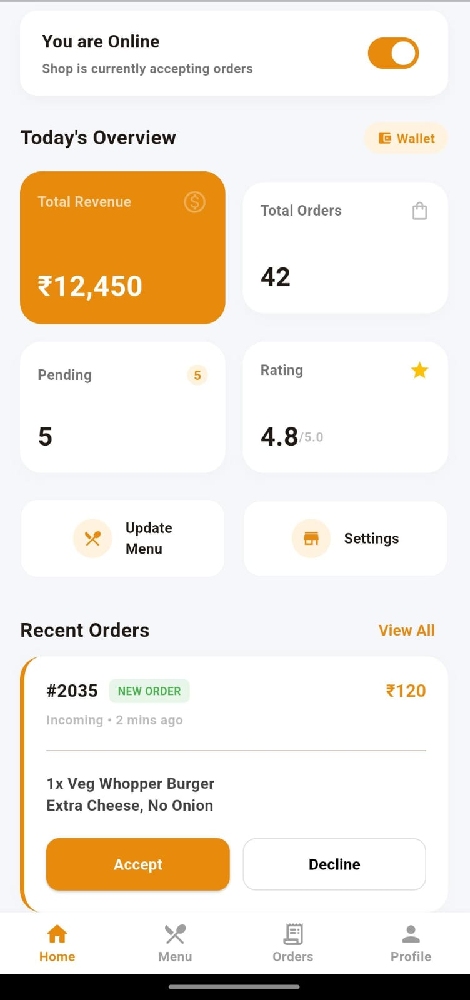
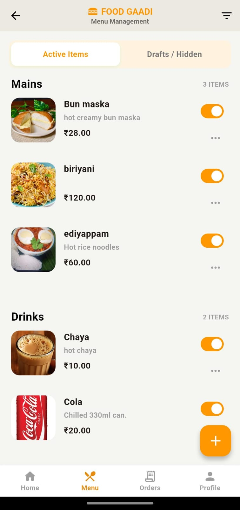
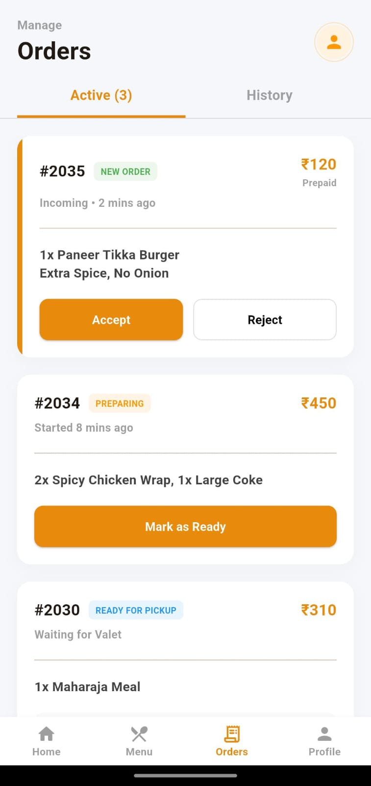

# Food Gaadi — vendor app prototype

A Flutter app exploring authentication, vendor profiles and menu management for food-truck businesses.

## Current status

| Area | Implementation |
| --- | --- |
| Authentication | Supabase email/password sign-up and login; confirmation prompt when required |
| Vendor profile | Reads the signed-in vendor's profile |
| Menu | Supabase CRUD, availability and image uploads |
| Orders and revenue | Sample data and interface demonstrations, not live order processing |
| Shop status and charts | Presentation prototype; no complete commerce backend |

## Screenshots

| Dashboard | Menu | Orders demo |
| --- | --- | --- |
|  |  |  |

## Run locally

Use Flutter with Dart 3.10 or newer, an Android/iOS development target and a fresh Supabase project. Native image uploads use `dart:io`; web support is not validated.

```bash
git clone https://github.com/sajee-sajee/food_gaadi_app.git
cd food_gaadi_app
flutter pub get
```

1. Run `supabase/schema.sql` in the SQL editor of a **fresh** Supabase project. It creates profiles, vendor-owned menu items, profile creation on sign-up, row-level security policies, realtime publication and the image bucket.
2. Copy the project URL and public anon key. Never use a service-role key in the app.
3. Run:

```bash
flutter run \
  --dart-define=SUPABASE_URL=https://YOUR_PROJECT.supabase.co \
  --dart-define=SUPABASE_ANON_KEY=YOUR_PUBLIC_ANON_KEY
```

Configuration is supplied at build time; there is no need to edit `lib/main.dart`. Supabase public client keys are not secrets; row-level security controls data access. Image files are public, while uploads and menu changes are restricted to the signed-in vendor.

The schema file is a fresh-project bootstrap, not an upgrade migration. Existing data needs a reviewed migration that assigns each menu item to its correct vendor; do not guess ownership or replace an existing database.

## Demo walkthrough

1. Register with truck name, location, email and password.
2. Confirm the email if requested, then sign in.
3. Add a menu item with a JPEG image; edit its price and toggle availability.
4. Sign in with a second vendor account and verify the first vendor's menu is not accessible.
5. Open the Orders demo and switch between active samples and history.

## Tests

```bash
flutter test
```

Tests cover missing configuration and the Orders demo's history navigation. They do not verify live Supabase access. Before sharing a release, run the walkthrough against a test project and verify row-level security with two distinct accounts.

## Structure

- `lib/main.dart`: initialization and session routing
- `lib/app_config.dart`: build-time configuration validation
- `lib/screens/`: login, dashboard, menu, orders and profile interfaces
- `supabase/schema.sql`: fresh-project database/storage setup
- `test/`: configuration and widget checks

## Next milestones

Connect real orders and revenue, complete vendor status persistence, add database integration tests, and validate native releases. This repository does not yet demonstrate a production food-delivery service, Docker deployment or a completed security audit.
